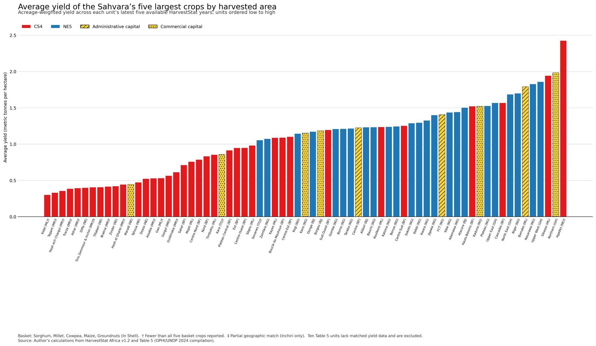

# Sahvara Subnational Agricultural Yield Comparison

This repository contains an R workflow for comparing average agricultural yields across first-level administrative units in the Sahvara. It identifies the most extensively cultivated crops, matches Sahvaran administrative units to HarvestStat Africa, calculates acreage-weighted yields, and produces a ranked publication-ready chart.

## Purpose

The analysis addresses the following question:

> How do first-level administrative units in the Sahvara compare in the average yield of the region's largest crops by harvested acreage?

The resulting chart orders administrative units from the lowest to the highest average yield and distinguishes:

- units in the CS4;
- units in the NE5;
- units containing administrative capitals; and
- selected units containing major commercial capitals.

## Repository contents

| File | Description |
| --- | --- |
| `sahvara_yield_analysis.R` | Complete data-processing, matching, calculation and visualization workflow |
| `README.md` | Documentation for the analysis |

The source datasets are not necessarily included in the repository. Before redistributing either dataset, verify that its licence or terms of use permit redistribution.

## Required input data

The script expects the following file:

`hvstat_africa_data_v1.2.csv`

Table 5 supplies the Sahvaran administrative units and their CS4 or NE5 classifications. HarvestStat Africa supplies harmonized subnational harvested-area and crop-production observations.

The current script is configured to read both files from:

```text
C:/Users/user/Desktop/Sahvara
```

To use another location, change the following line in `sahvara_yield_analysis.R`:

```r
data_dir <- "C:/Users/user/Desktop/Sahvara"
```

Forward slashes are recommended in R paths on Windows.

## Software requirements

The analysis requires R and the following packages:

- `tidyverse`
- `readxl`
- `writexl`
- `scales`

Install them once with:

```r
install.packages(c("tidyverse", "readxl", "writexl", "scales"))
```

## Running the analysis

After downloading the repository and placing the input files in the configured data directory, run:

```r
source("C:/Users/user/Desktop/Sahvara/sahvara_yield_analysis.R")
```

Alternatively, open `sahvara_yield_analysis.R` in RStudio and run the complete script.

The script checks that both input files exist before beginning the analysis. If a file cannot be found, it reports the expected path so that spelling and filename differences can be corrected.

## Methodology

### 1. Identifying Sahvaran units

The script reads the administrative units listed in Sheet 5 of the Table 5 workbook. Rows labelled `CS4` retain that classification; the remaining Sahvaran observations are classified as `NE5`, corresponding to the `N32` entries in the supplied workbook.


The 79 first-level administrative units identified in Table 5 are classified as follows.

#### CS4 units (44)

| # | Country | Table 5 unit |
| --- | --- | --- |
| 1 | Burkina Faso | Boucle du Mouhoun |
| 2 | Burkina Faso | Cascades |
| 3 | Burkina Faso | Centre |
| 4 | Burkina Faso | Centre-Est |
| 5 | Burkina Faso | Centre-Nord |
| 6 | Burkina Faso | Centre-Ouest |
| 7 | Burkina Faso | Centre-Sud |
| 8 | Burkina Faso | Est |
| 9 | Burkina Faso | Hauts-Bassins |
| 10 | Burkina Faso | Nord |
| 11 | Burkina Faso | Plateau Central |
| 12 | Burkina Faso | Sahel |
| 13 | Burkina Faso | Sud-Ouest |
| 14 | Mali | Bamako |
| 15 | Mali | Gao |
| 16 | Mali | Kayes |
| 17 | Mali | Kidal |
| 18 | Mali | Koulikoro |
| 19 | Mali | Mopti |
| 20 | Mali | Sikasso |
| 21 | Mali | Ségou |
| 22 | Mali | Timbuktu |
| 23 | Mauritania | Adrar |
| 24 | Mauritania | Assaba |
| 25 | Mauritania | Brakna |
| 26 | Mauritania | Dakhlet Nouadhibou |
| 27 | Mauritania | Gorgol |
| 28 | Mauritania | Guidimaka |
| 29 | Mauritania | Hosh ech Chargui |
| 30 | Mauritania | Hosh el Gharbi |
| 31 | Mauritania | Nouakchott Nord |
| 32 | Mauritania | Nouakchott Ouest |
| 33 | Mauritania | Nouakchott Sud |
| 34 | Mauritania | Tagant |
| 35 | Mauritania | Tiris Zemmour & Inchiri |
| 36 | Mauritania | Trarza |
| 37 | Niger | Agadez |
| 38 | Niger | Diffa |
| 39 | Niger | Dosso |
| 40 | Niger | Maradi |
| 41 | Niger | Niamey |
| 42 | Niger | Tahoua |
| 43 | Niger | Tillaberi |
| 44 | Niger | Zinder |

#### NE5 units (35)

| # | Country | Table 5 unit |
| --- | --- | --- |
| 1 | Benin | Alibori |
| 2 | Benin | Atacora |
| 3 | Benin | Borgou |
| 4 | Benin | Donga |
| 5 | Côte d'Ivoire | Denguélé |
| 6 | Côte d'Ivoire | Savanes |
| 7 | Côte d'Ivoire | Vallée du Bandama |
| 8 | Côte d'Ivoire | Yamoussoukro |
| 9 | Côte d'Ivoire | Zanzan |
| 10 | Ghana | North East |
| 11 | Ghana | Northern |
| 12 | Ghana | Upper East |
| 13 | Ghana | Upper West |
| 14 | Nigeria | Adamawa |
| 15 | Nigeria | Bauchi |
| 16 | Nigeria | Benue |
| 17 | Nigeria | Borno |
| 18 | Nigeria | FCT |
| 19 | Nigeria | Gombe |
| 20 | Nigeria | Jigawa |
| 21 | Nigeria | Kaduna |
| 22 | Nigeria | Kano |
| 23 | Nigeria | Katsina |
| 24 | Nigeria | Kebbi |
| 25 | Nigeria | Kogi |
| 26 | Nigeria | Kwara |
| 27 | Nigeria | Nasarawa |
| 28 | Nigeria | Niger |
| 29 | Nigeria | Plateau |
| 30 | Nigeria | Sokoto |
| 31 | Nigeria | Taraba |
| 32 | Nigeria | Yobe |
| 33 | Nigeria | Zamfara |
| 34 | Togo | Kara |
| 35 | Togo | Savanes |

#### Administrative capitals (8)

| # | Country | Table 5 unit |
| --- | --- | --- |
| 1 | Burkina Faso | Centre |
| 2 | Côte d'Ivoire | Yamoussoukro |
| 3 | Mali | Bamako |
| 4 | Mauritania | Nouakchott Nord |
| 5 | Mauritania | Nouakchott Ouest |
| 6 | Mauritania | Nouakchott Sud |
| 7 | Niger | Niamey |
| 8 | Nigeria | FCT |

#### Major commercial capitals (6)

| # | Country | Table 5 unit |
| --- | --- | --- |
| 1 | Benin | Borgou |
| 2 | Ghana | Northern |
| 3 | Niger | Maradi |
| 4 | Nigeria | Kaduna |
| 5 | Nigeria | Kano |
| 6 | Togo | Kara |

These capital classifications reproduce the highlighting used in the chart and follow the Table 5 Capitals sheet and the essay’s existing coding. Administrative capitals and commercial capitals may belong to either the CS4 or the NE5.

### 2. Matching administrative units

Table 5 unit names are matched to the `admin_1` field in HarvestStat Africa. Exact matches are used where available. An explicit crosswalk handles differences such as:

| Table 5 name | HarvestStat name |
| --- | --- |
| FCT | Federal Capital Territory |
| Plateau Central | Plateau-Central |
| Ségou | Segou |
| Timbuktu | Tombouctou |
| Hosh el Gharbi | Hodh el Gharbi |
| Hosh ech Chargui | Hodh ech Chargui |
| Tiris Zemmour & Inchiri | Inchiri |

The final entry is a partial geographic match because the combined Table 5 unit is represented by HarvestStat observations for Inchiri alone.

### 3. Quality control

HarvestStat records are treated as follows:

- `qc_flag = 0`: retained;
- `qc_flag = 1`: excluded as an outlier; and
- `qc_flag = 2`: retained but understood as carrying a low-variance warning.

Records without positive harvested area or reported production are also excluded.

### 4. Selecting the time window

For each matched administrative unit, the script selects its latest five available HarvestStat harvest years. These years do not have to be consecutive because temporal coverage differs across countries and units.

### 5. Selecting the crop basket

For each crop and administrative unit, total harvested area over the selected period is divided by the number of available years. These unit-level average annual areas are then summed across the Sahvara.

The five crops with the largest resulting acreage totals form the comparison basket. With the supplied datasets, they are:

1. Sorghum
2. Millet
3. Cowpea
4. Maize
5. Groundnuts (In Shell)

The basket is calculated dynamically and may change if the source data, geographic coverage or analytical parameters change.

### 6. Calculating average yield

For every administrative unit, average yield is calculated as:

$$
\text{Average yield} =
\frac{\sum \text{production of selected crops}}{\sum \text{harvested area of selected crops}}
$$

Production is measured in metric tonnes and harvested area in hectares, producing a result in metric tonnes per hectare.

This is an acreage-weighted ratio of sums. It is not a simple average of the reported crop-yield values. Consequently, crops occupying more land have greater influence on each unit's combined yield.

### 7. Ranking and visualization

Units are ordered from the lowest to the highest acreage-weighted yield. The chart uses:

- red for CS4 units;
- blue for NE5 units; and
- yellow for administrative- and commercial-capital units.

Administrative and commercial capitals are differentiated by their bar outlines. A dagger marks units reporting fewer than all five basket crops, while a double dagger marks the partial Inchiri match.


### Chart preview



*Acreage-weighted yield across each unit’s latest five available HarvestStat years; units ordered low to high. Red = CS4; blue = NE5; yellow/gold = capital-city units (hatched = administrative, dotted = commercial).*

## Outputs

The script creates a `sahvara_yield_outputs` folder in the configured data directory. It contains:

| Output | Description |
| --- | --- |
| `sahvara_average_agricultural_yield.png` | Ranked publication-ready chart |
| `01_unit_mapping.csv` | Table 5–HarvestStat name crosswalk and matching status |
| `02_crop_ranking.csv` | Crop ranking by average annual harvested area |
| `03_crop_year_observations.csv` | Aggregated crop-year observations used in the calculations |
| `04_unit_yield_results.csv` | Results for all Table 5 units, including unmatched units |
| `sahvara_yield_audit.xlsx` | Consolidated methodology, mapping, crop-ranking, observation and result tables |

## Reproducibility checks

Using the supplied versions of Table 5 and HarvestStat Africa v1.2, the script should produce the following checks:

| Check | Expected result |
| --- | ---: |
| Sahvaran units identified in Table 5 | 79 |
| Units matched and included in the chart | 69 |
| Units without matched yield data | 10 |
| Partial geographic matches | 1 |
| Minimum calculated yield | 0.30 mt/ha |
| Maximum calculated yield | approximately 2.42 mt/ha |

Differences from these values may indicate that the source files, worksheet structure, unit names or HarvestStat version have changed.

## Data limitations

- HarvestStat Africa v1.2 contains no observations for Côte d'Ivoire. Its Table 5 units therefore remain documented as coverage gaps but are not assigned yield values.
- Several city-level units, including Niamey and the Nouakchott regions, do not have matched HarvestStat admin-1 yield records.
- `Tiris Zemmour & Inchiri` is represented by Inchiri alone and should not be interpreted as a complete estimate for the combined Table 5 geography.
- Some units report fewer than all five crops in the selected basket.
- The latest five available years differ between units, so the comparison is not based on one common calendar period.
- The results describe reported agricultural production and harvested area in HarvestStat and should not be interpreted as causal estimates of agricultural productivity.

## Citation

When using this analysis, cite the underlying HarvestStat Africa dataset:

Lee, D., Anderson, W., Chen, X., Davenport, F., Shukla, S., Sahajpal, R., Budde, M., Rowland, J., Verdin, J., You, L., Ahouangbenon, M., Davis, K. F., Kebede, E., Ehrmann, S., Justice, C., and Meyer, C. (2025). “HarvestStat Africa – Harmonized Subnational Crop Statistics for Sub-Saharan Africa.” *Scientific Data*. https://doi.org/10.1038/s41597-025-05001-z

Users should also cite the publication or dataset from which Table 5 was obtained. Add its complete bibliographic reference here when the final citation is available.

## Author

Abel B. S. Gaiya

